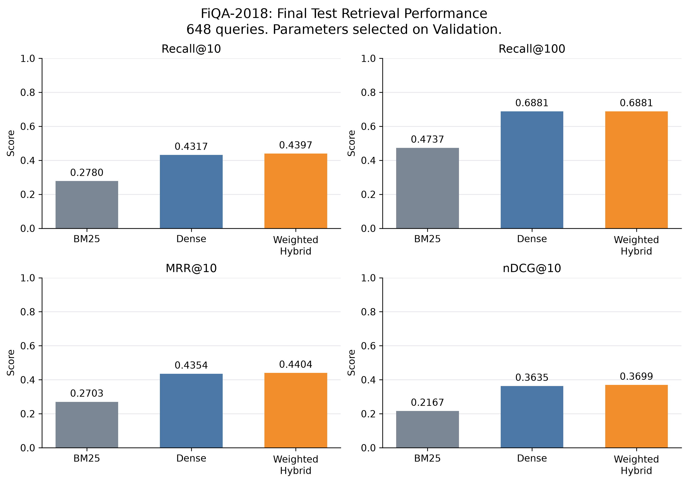
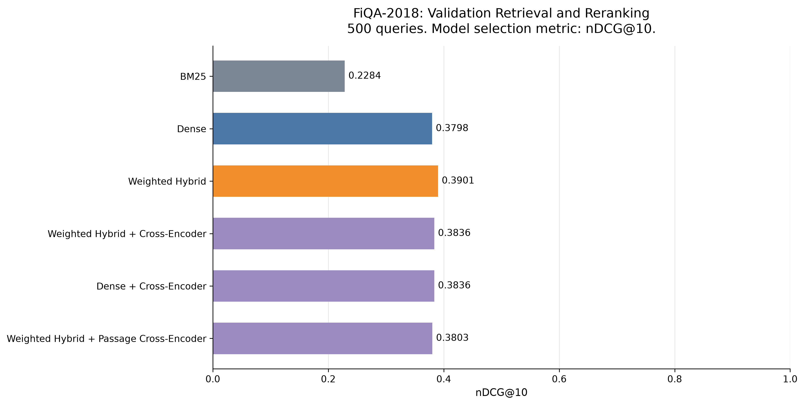

# Hybrid Semantic Search and Neural Reranking for Financial Question Answering

A financial document retrieval project on BEIR FiQA-2018, comparing BM25, dense semantic retrieval, weighted Reciprocal Rank Fusion (RRF), and neural reranking. Models are used for inference without fine-tuning.

## Results

### Final Test: 648 Queries

Weighted Hybrid was selected on Validation before final Test evaluation.

| Method | Recall@10 | Recall@100 | MRR@10 | nDCG@10 |
|---|---:|---:|---:|---:|
| BM25 | 0.278013 | 0.473669 | 0.270286 | 0.216684 |
| Dense | 0.431690 | 0.688115 | 0.435371 | 0.363460 |
| **Weighted Hybrid** | 0.439712 | 0.688115 | 0.440430 | **0.369861** |



Hybrid improves Test nDCG@10 over Dense by **0.006401**, approximately **1.76% relative**. Recall@10 and MRR@10 also increase; Recall@100 remains equal.

Source: [Test metrics](results/test_baselines.csv).

### Validation: 500 Queries

| Method | Recall@10 | Recall@100 | MRR@10 | nDCG@10 |
|---|---:|---:|---:|---:|
| BM25 | 0.271037 | 0.468211 | 0.287029 | 0.228423 |
| Dense | 0.444063 | 0.691544 | 0.451139 | 0.379798 |
| **Weighted Hybrid** | 0.451300 | 0.691544 | 0.465729 | **0.390140** |
| Weighted Hybrid + Cross-Encoder | 0.455475 | 0.691544 | 0.456533 | 0.383587 |
| Dense + Cross-Encoder | 0.455475 | 0.691544 | 0.456533 | 0.383587 |
| Weighted Hybrid + Passage Cross-Encoder | 0.447088 | 0.691544 | 0.457879 | 0.380282 |



Weighted Hybrid achieved the highest Validation nDCG@10 among the evaluated configurations. Neither whole-document nor passage-based reranking improved this metric.

Sources: [baselines](results/validation_baselines.csv), [Hybrid reranking](results/reranker_validation.csv), [Dense reranking](results/dense_reranker_validation.csv), and [passage reranking](results/passage_reranker_validation.csv).

## Dataset and Evaluation

[FiQA-2018](https://huggingface.co/datasets/BeIR/fiqa), from the [BEIR benchmark](https://github.com/beir-cellar/beir), contains 57,638 corpus documents and 6,648 queries. Retrieval uses document text.

| Split | Queries | Purpose |
|---|---:|---|
| Train | 5,500 | Unused |
| Validation | 500 | Parameter selection, method comparison, and error analysis |
| Test | 648 | Final evaluation with fixed methods and parameters |

Metrics use the original binary relevance labels (qrels), calculated per query and averaged. **Validation nDCG@10** determines model selection. Development scripts load only Validation qrels; Test evaluation has a separate entrypoint and is not used for tuning.

## Methods

| Method | Configuration |
|---|---|
| BM25 | BM25Okapi, lowercase text, regex tokenization |
| Dense | [multi-qa-MiniLM-L6-cos-v1](https://huggingface.co/sentence-transformers/multi-qa-MiniLM-L6-cos-v1), normalized 384-dimensional embeddings, inner-product scoring |
| Weighted Hybrid | Weighted RRF: `rrf_k=60`, 100 candidates per route, BM25 weight 0.10, Dense weight 1.00 |
| Whole-document reranking | [ms-marco-MiniLM-L6-v2](https://huggingface.co/cross-encoder/ms-marco-MiniLM-L6-v2) Cross-Encoder reranks Top-100 candidates |
| Passage-based reranking | Same Cross-Encoder, 400-token document windows, 80-token overlap, maximum passage score per document |

BM25 weight 0.10 was selected among [11 recorded Validation candidates](results/hybrid_weight_search.csv). The Cross-Encoder input limit is 512 tokens including the query and special tokens; passage scoring checks each input pair against this limit.

## Error Analysis

Per-query nDCG@10 changes relative to Weighted Hybrid across all 500 Validation queries:

| Reranking method | Improved | Worsened | Unchanged | Mean change |
|---|---:|---:|---:|---:|
| Whole-document | 122 | 144 | 234 | -0.006553 |
| Passage-based | 123 | 142 | 235 | -0.009858 |

**Long-document case — Query 7681:** a merger cost-basis question. The input for relevant document `307602` exceeded the 512-token limit.

| Method | First relevant rank | Recall@10 | nDCG@10 |
|---|---:|---:|---:|
| Weighted Hybrid | 1 | 1.0 | 0.919721 |
| Whole-document reranking | 7 | 0.5 | 0.204382 |
| Passage-based reranking | 1 | 0.5 | 0.613147 |

Passage scoring partially recovered this case, but remained below Hybrid and did not improve overall Validation performance. Truncation was not isolated as the sole cause of the regression.

Detailed cases and scores: [Validation experiment record, prepared before final Test](results/validation_experiments.md). Per-query data: [whole-document](results/reranking_error_analysis.csv) and [passage-based](results/passage_reranking_error_analysis.csv).

## Environment and Installation

Tested on macOS arm64 with Python 3.11.17, PyTorch 2.14.1 and Sentence Transformers 6.1.0, using MPS on an Apple M5 Pro with 24 GB RAM. The implementation falls back to CPU when MPS is unavailable.

Direct dependencies and selected model-stack dependencies are pinned in [requirements.txt](requirements.txt); this is not a complete environment lock. The [Test-time environment snapshot](results/final_evaluation_environment.txt) was captured before Matplotlib was added.

For macOS 14 or newer with native arm64 Conda, run the following from the repository root.

**Downloads:** Budget approximately **300–600 MB** for Python and packages; actual transfer depends on package resolution and caches. Model weights and FiQA data are downloaded separately on first use.

```bash
conda create -n fiqa_reproduction python=3.11.17 pip
conda activate fiqa_reproduction
python -m pip install -r requirements.txt
```

Check dependency compatibility and MPS availability:

```bash
python -m pip check
python -c "import torch; print('MPS available:', torch.backends.mps.is_available())"
```

`pip check` should report `No broken requirements found.` The original working environment passed this check; a clean-environment installation has not yet been validated.

## Usage

Run commands from the repository root. Validation commands overwrite their corresponding CSVs under `results/`; use a separate working copy to preserve the recorded results.

**First-run downloads:** FiQA data is approximately **30 MB**; Dense model weights are approximately **91 MB** for semantic retrieval. Reranking additionally downloads approximately **91 MB** of Cross-Encoder weights. Tokenizer/configuration files add a small amount; existing caches reduce downloads.

Evaluate the three retrieval baselines on Validation:

```bash
python main.py
```

Optional Validation experiments:

```bash
# Search Hybrid weights
python -m scripts.search_hybrid_weights

# Evaluate whole-document and passage-based reranking
python -m scripts.evaluate_reranker --reranker whole
python -m scripts.evaluate_dense_reranker
python -m scripts.evaluate_reranker --reranker passage

# Generate per-query error analysis
python -m scripts.analyze_reranking --reranker whole
python -m scripts.analyze_reranking --reranker passage
```

Regenerate figures from the included CSVs. These commands load no models or qrels and replace the corresponding PNG/SVG figures:

```bash
python -m scripts.plot_validation_results
python -m scripts.plot_test_results
```

Final Test results are already included. `scripts/evaluate_test.py` requires `--run-test` and refuses to overwrite an existing `results/test_baselines.csv`. The fixed configuration is recorded in the [final evaluation plan](results/final_evaluation_plan.md).

## Project Structure

```text
fiqa_hybrid_search/
├── main.py              # Validation retrieval baselines
├── src/                 # Retrieval, reranking, data loading and metrics
├── scripts/             # Experiments, case inspection and plotting
├── results/             # CSVs, figures and experiment records
├── requirements.txt
├── README.md
└── .gitignore
```

## Reproducibility and Limitations

- Dense indexing creates `data/cache/corpus_embeddings.pt` locally (approximately 89 MB). Cache reuse checks model and corpus metadata; the cache uses no qrels and is excluded from version control.
- Model names and dependency versions are recorded, but Hugging Face model revisions are not pinned in code.
- Reranking conclusions apply to the evaluated model and passage configuration. Possible incomplete qrels annotations require independent verification; reported metrics use the unchanged original labels.
- Statistical significance and runtime performance have not been assessed.